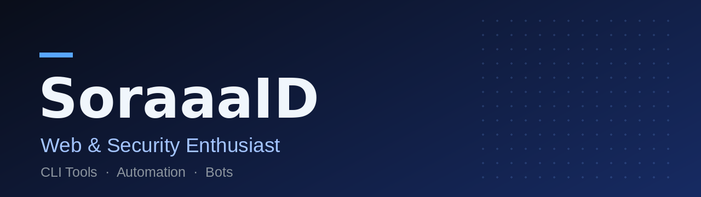
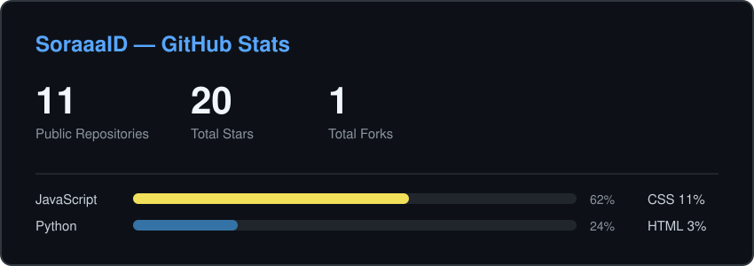

 

---

## 👋 About Me

Pembelajar otodidak dengan rasa ingin tahu yang besar — selalu tertarik mempelajari hal baru, terutama seputar perangkat lunak. Fokus saya membangun tool CLI, bot, dan otomasi: sebagian besar proyek berangkat dari kebutuhan pribadi, lalu dipoles sampai layak dipakai orang lain — terdokumentasi, teruji, dan terus dirawat.

- 🔭 Saat ini mengembangkan tool developer berbasis **Python** dan **Node.js**
- 🌱 Sedang mendalami keamanan web dan otomasi infrastruktur, sambil terus membuka diri untuk bidang baru apa pun
- 💡 Prinsip: buat yang sederhana, ukur dengan data, perbaiki terus

---

## 💻 Tech Stack

  
  
  
  
  
  
  
  

---

## 🚀 Featured Projects

| Project | Deskripsi |
| ------- | --------- |
| [Termux-Package](https://github.com/SoraaaID/Termux-Package) | Installer package Termux untuk pemula — instalasi batch & paralel, lewati yang sudah terpasang, plus mode CLI non-interaktif |
| [ui-design-review-bot](https://github.com/SoraaaID/ui-design-review-bot) | CLI Node.js untuk membandingkan desain Figma dengan web live: diff piksel, audit tipografi, cek kontras WCAG, dan laporan checklist beranotasi |
| [issue-triage-bot](https://github.com/SoraaaID/issue-triage-bot) | Bot GitHub Actions bertenaga Gemini AI: triase issue otomatis — cek duplikat, cari file terkait, pasang label & prioritas, hingga draft PR |
| [keuanganku](https://github.com/SoraaaID/keuanganku) | Aplikasi pencatat keuangan offline-first untuk Android & PWA, dibangun dengan Vanilla JS dan Capacitor |
| [proxy-scraper](https://github.com/SoraaaID/proxy-scraper) | Scraper proxy publik dengan validasi koneksi dan klasifikasi anonimitas, diperbarui otomatis via GitHub Actions |
| [py-analysis-tool](https://github.com/SoraaaID/py-analysis-tool) | Toolkit CLI untuk inspeksi bytecode Python (.pyc) dan format aplikasi terpaket, lengkap dengan laporan HTML |

---

## 📊 GitHub Stats

---

## 🎬 Showreel

https://github.com/user-attachments/assets/ce745c6e-5267-498f-86ff-2b29fcdb56b0

---

## 🌐 Socials

  
  
  
  

---

## 💰 Support Me

  

Terima kasih sudah mampir. Jangan ragu membuka issue atau fork di repo mana pun yang bermanfaat buatmu.

